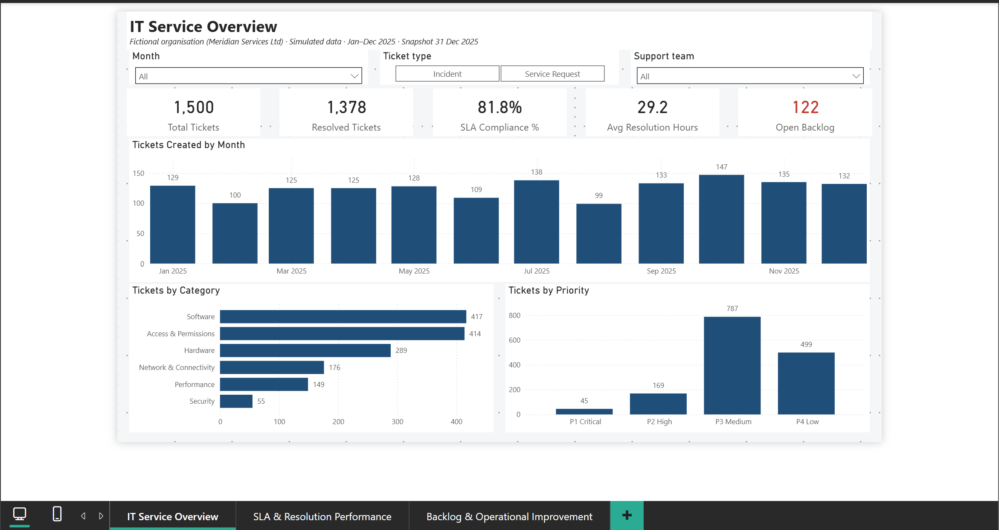
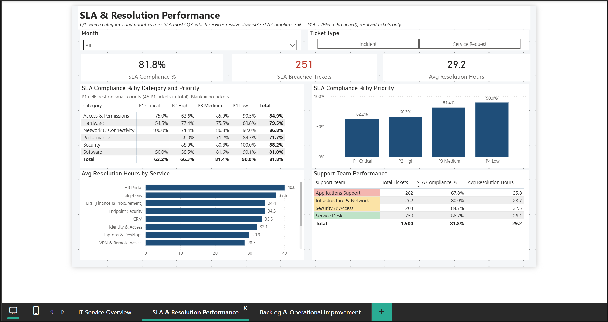
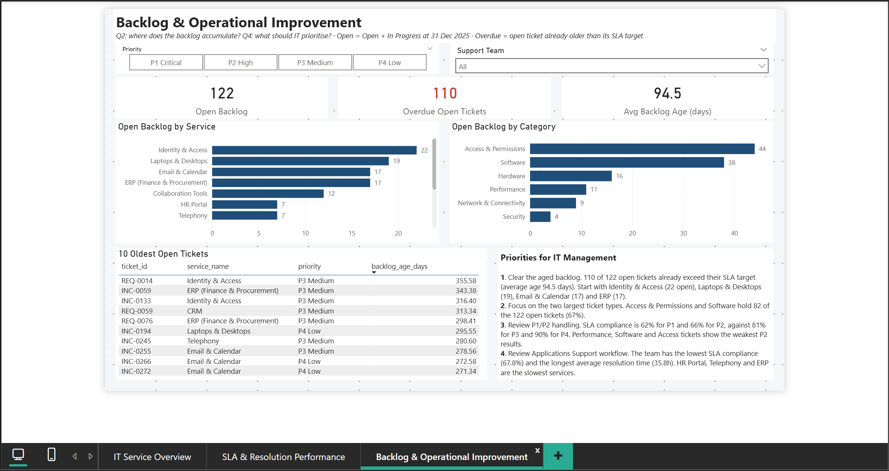
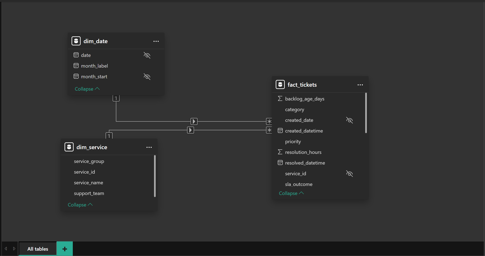

# IT Service Management & SLA Performance Analytics

### Incident, Service Request, SLA Compliance & Backlog Analytics Dashboard


---

## Project Overview

This project presents a simulated **IT service performance analytics solution** for **Meridian Services Ltd**, a fictional mid-sized company whose IT support organisation handles incidents and service requests across 12 IT services and 4 support teams.

It is the final domain project in my portfolio (Systems / IT Management). It focuses on **measuring service performance**: which tickets miss their SLA, where unresolved tickets accumulate, and which services resolve slowest.

The report separates **SLA targets** (the policy) from **actual outcomes** (Met, Breached, Open - Within SLA, Open - Overdue), and reports overdue open tickets next to SLA compliance so that compliance is never flattered by tickets that have not yet closed.

### Headline position (12 months, snapshot 31 Dec 2025)

| KPI | Result |
| --- | --- |
| Total Tickets | **1,500** (1,100 incidents, 400 service requests) |
| Resolved Tickets | **1,378** |
| SLA Compliance % (resolved tickets only) | **81.8%** (1,127 met, 251 breached) |
| Avg Resolution Hours (resolved tickets) | **29.2 hours** |
| Open Backlog (Open + In Progress) | **122** (8.1% of tickets) |
| Overdue Open Tickets (already past SLA target) | **110** of 122 |
| Avg Backlog Age | **94.5 days** |

> **Core business question:** Where does IT service delivery miss its SLAs, where is unresolved work building up, and what should IT management prioritise?
> All data is **fictional and synthetic**. See [Limitations](#limitations) and [Disclaimer](#disclaimer).

---

## Business Context

Meridian Services Ltd runs a central IT support function. The dataset covers:

- **12** IT services in **5** service groups, owned by **4** support teams (Service Desk, Infrastructure & Network, Applications Support, Security & Access)
- **1,500** tickets created between 1 Jan and 31 Dec 2025
- **4** priority levels (P1 Critical to P4 Low) and **6** ticket categories
- A resolution-time SLA target per ticket type and priority

Management concerns: SLA breaches on high-priority tickets, a backlog of tickets that are already overdue, slow-resolving services, and unequal performance between support teams.

---

## Business Objectives

Management needs to:

1. Identify which categories and priorities miss SLA targets most often.
2. Locate where the unresolved ticket backlog is accumulating and how old it is.
3. Find the services with the longest resolution times.
4. Compare performance across support teams.
5. Translate the findings into prioritised operational improvements.

---

## Key Business Questions

1. Which incident categories and priorities miss SLAs most often?
2. Where is the unresolved ticket backlog accumulating?
3. Which services have the longest resolution times?
4. What operational improvements should IT management prioritise?

---

## Data & Analytical Model

A simple star schema: one ticket fact table and two small dimensions.

```
dim_service ───► fact_tickets ◄─── dim_date
```

| Table | Grain |
| --- | --- |
| `fact_tickets` | One row per ticket (1,500 rows, 13 columns) |
| `dim_service` | One row per IT service (12 rows): service, service group, owning support team |
| `dim_date` | One row per day of 2025 (365 rows): date, month start, month label |

**SLA policy (resolution target, calendar hours)**

| Ticket type | P1 Critical | P2 High | P3 Medium | P4 Low |
| --- | --- | --- | --- | --- |
| Incident | 4h | 8h | 24h | 72h |
| Service Request | n/a | n/a | 48h | 120h |

**Prepared in the source data, not in DAX.** `sla_target_hours`, `resolution_hours`, `sla_outcome` and `backlog_age_days` are calculated once in the generator and independently re-derived by the validation script, so the Power BI model needs no calculated columns.

Detailed field definitions are in [`documentation/Data_Dictionary.md`](documentation/Data_Dictionary.md).

---

## Key Performance Indicators

| Area | KPI | Business Logic |
| --- | --- | --- |
| Volume | Total Tickets | Count of tickets |
| Volume | Resolved Tickets | Tickets with status Resolved |
| Backlog | Open Backlog | Tickets with status Open or In Progress at the snapshot |
| SLA | SLA Met Tickets | Resolved tickets whose resolution time is within target |
| SLA | SLA Breached Tickets | Resolved tickets whose resolution time exceeds target |
| SLA | **SLA Compliance %** | Met / (Met + Breached). Resolved tickets only |
| Speed | **Avg Resolution Hours** | Mean elapsed calendar hours from creation to resolution, resolved tickets only |
| Backlog | **Overdue Open Tickets** | Open tickets whose age at the snapshot already exceeds their SLA target |
| Backlog | Avg Backlog Age (days) | Mean age at the snapshot of open tickets |

Open tickets are excluded from SLA Compliance % and reported separately as Overdue Open Tickets. An open ticket past its target is **overdue**, not a recorded breach, because it has not been resolved yet.

Detailed DAX logic is in [`documentation/DAX_Measures.md`](documentation/DAX_Measures.md).

---

## Power BI Dashboard

The report contains three pages that move from **overview** to **SLA diagnosis** to **backlog and action**.

### 1. IT Service Overview

Headline KPIs, ticket volume by month, tickets by category and by priority. Slicers: month, ticket type, support team.



### 2. SLA & Resolution Performance

SLA compliance by category and priority (matrix with conditional formatting), compliance by priority, average resolution hours by service, and a support-team performance table. Answers Q1 and Q3.



### 3. Backlog & Operational Improvement

Open backlog and overdue tickets by service and category, the 10 oldest open tickets, and the management priorities. Answers Q2 and Q4.



### Data model



---

## Key Findings

The findings describe the **simulated dataset**. Differences between teams, categories and services, and the likelihood of tickets staying open, were seeded in the generator, so these results illustrate the analytical method and are not real-world evidence. No causal claims are made.

1. **SLA compliance falls as priority rises.** P1 62.2%, P2 66.2%, P3 81.4%, P4 90.0%. P1 has only 45 tickets, so its rate is sensitive to a few cases.
2. **Performance is the weakest category (71.7%); Security is the strongest (88.2%).** The weakest sizeable P2 cells are Performance (56.0%), Software (58.5%) and Access & Permissions (63.6%), each based on 25 to 41 resolved tickets.
3. **By volume, P3 produces the most breaches** (136 of 251), and Software the most by category (72).
4. **110 of the 122 open tickets are already past their SLA target.** Average age is 94.5 days, 27 tickets are older than 180 days, and the 10 oldest (all P3/P4) are 272 to 356 days old.
5. **Backlog is concentrated.** Identity & Access (22), Laptops & Desktops (19), Email & Calendar (17) and ERP (17) hold 75 of the 122 open tickets. Access & Permissions (44) and Software (38) hold 82 (67%).
6. **Slowest services are HR Portal (40.0h), Telephony (37.6h) and ERP (34.4h);** the fastest are Printing (19.7h) and Email & Calendar (21.1h).
7. **Applications Support has the lowest compliance (67.8%) and longest average resolution (35.8h).** The Service Desk handles about half of all tickets at 86.7% compliance but still records the most breaches by volume (93).

Full detail is in [`documentation/Insights_and_Strategy.md`](documentation/Insights_and_Strategy.md).

---

## Management Recommendations

All targets are **proposed management targets**, not proven results. No financial or productivity savings are claimed.

| Priority | Area | Recommended Action | Proposed Target |
| --- | --- | --- | --- |
| **P1** | Backlog | Triage the 110 overdue open tickets, starting with Identity & Access, Laptops & Desktops, Email & Calendar and ERP; close or re-validate stale tickets | No open ticket older than 180 days at the monthly review (27 today) |
| **P1** | High-priority handling | Review the P1 and P2 breaches, starting with Performance, Software and Access & Permissions at P2 | SLA compliance of 90% or more for P1 and P2 |
| **P2** | Ticket types | Review how Access & Permissions and Software tickets are queued and tracked (67% of open tickets) | No Access & Permissions or Software ticket open beyond its SLA target at the monthly review |
| **P2** | Team workflow | Review Applications Support workflow and the slowest services (HR Portal, Telephony, ERP) | Applications Support compliance of 80% or more |
| **P3** | Reporting | Report Overdue Open Tickets next to SLA Compliance % in monthly management reporting | Both metrics in every monthly pack |

These are prioritisation and investigation steps. The data shows **where** misses and backlog sit, not **why**.

---

## Analytical Methodology

The project follows a business-first workflow:

**Business Problem → Scope & Schema → Data Generation → Validation → Python EDA → Power BI Model → DAX → Dashboard → Insights → Recommendations**

### Python

- Seeded synthetic dataset generation
- Independent validation script (28 checks)
- Brief exploratory analysis and reference KPI values using the same definitions as the report

### Power BI

- Star-schema model with 2 relationships
- 9 DAX measures, no calculated columns
- Three-page report with a small set of slicers and no drill-through, bookmarks or custom tooltips

### Policy assumptions

- SLA targets are calendar hours (24x7), by ticket type and priority
- Snapshot date is 31 Dec 2025, 23:59
- SLA Compliance % covers resolved tickets only
- Matrix colours (green at 85% or more, amber 75 to 85%, red below 75%) are display thresholds, not organisational SLA targets

---

## Data Validation

The validation script runs **28 checks**: row counts, key uniqueness, duplicates, required-field nulls, referential integrity, date logic, status consistency, recalculation of resolution hours and backlog age, SLA target lookup, SLA outcome recalculation, allowed values and plausibility ranges. **Result: 28 passed, 0 failed.** The full output is in [`documentation/validation_report.txt`](documentation/validation_report.txt).

All 9 KPI values in Power BI were reconciled to the pandas reference values in [`documentation/eda/eda_summary.txt`](documentation/eda/eda_summary.txt).

---

## Tools & Technologies

- **Power BI Desktop**: data modelling, DAX and dashboard development
- **Python 3**: dataset generation, validation and EDA
- **Pandas / NumPy**: data preparation and analysis
- **CSV**: dataset storage

---

## Repository Structure

```
IT-Service-SLA-Analytics/
│
├── README.md
│
├── data/
│   ├── dim_service.csv
│   ├── dim_date.csv
│   └── fact_tickets.csv
│
├── python/
│   ├── generate_data.py
│   ├── validate_data.py
│   ├── exploratory_analysis.py
│   └── requirements.txt
│
├── Powerbi/
│   └── IT_Service_SLA_Dashboard.pbix
│
├── documentation/
│   ├── Business_Case.md
│   ├── Data_Dictionary.md
│   ├── DAX_Measures.md
│   ├── Insights_and_Strategy.md
│   ├── validation_report.txt
│   └── eda/
│       └── eda_summary.txt
│
└── Screenshots/
    ├── 01_it_service_overview.png
    ├── 02_sla_resolution_performance.png
    ├── 03_backlog_operational_improvement.png
    └── 04_data_model.png
```

---

## How to Reproduce

### 1. Install Python dependencies

```
pip install -r python/requirements.txt
```

### 2. Generate the dataset (fixed random seed)

```
python python/generate_data.py
```

### 3. Validate the dataset

```
python python/validate_data.py
```

### 4. Run exploratory analysis

```
python python/exploratory_analysis.py
```

### 5. Open the Power BI report

Open `Powerbi/IT_Service_SLA_Dashboard.pbix` in Power BI Desktop. If the CSV paths do not resolve on your machine, go to **Transform data → Data source settings → Change Source** and point each file to `data/`, then click **Refresh**. Reconcile the 9 measures against the reference block in `documentation/eda/eda_summary.txt` (1,500 / 1,378 / 122 / 81.79% / 29.18).

> Outputs depend on the NumPy and pandas versions. The validation script confirms integrity regardless of version. Exact figures in this README correspond to the committed CSV files.

---

## Documentation

- [`Business Case`](documentation/Business_Case.md): business context, scope and objectives
- [`Data Dictionary`](documentation/Data_Dictionary.md): tables, fields, generator rules and model notes
- [`DAX Measures`](documentation/DAX_Measures.md): measures used in the Power BI model
- [`Insights & Strategy`](documentation/Insights_and_Strategy.md): findings, implications and recommendations

---

## Limitations

- **Synthetic data.** Fictional company, seeded patterns, a single 12-month window.
- **Calendar-hour SLAs.** No business-hours calendars, on-hold or pause clocks, or response-time SLAs.
- **Open tickets sit outside SLA Compliance %.** If the 110 overdue open tickets were counted as breaches, compliance would be about 75.7% (1,127 / 1,488).
- **Snapshot view.** Backlog is as at 31 Dec 2025; there is no historical backlog trend.
- **Small samples.** P1 (45 tickets) and some category-by-priority cells have few tickets.
- **Average Resolution Hours is not adjusted for priority mix.** Services with more low-priority tickets have longer targets, so compare hours alongside SLA Compliance %.
- **Not modelled:** individual agents, cost, customer satisfaction, reopen rates, forecasting.
- The management-priorities text box on Page 3 is static and does not respond to slicers.
- The report **does not change** any ITSM system or process.

---

## Disclaimer

This is a simulated portfolio project created for learning and professional demonstration purposes. The company, operational data, scenarios and recommendations are fictional and do not represent the performance or internal operations of a real organisation.

---

## Author

**Sarthak Jaykar** B.Tech Computer Science + MBA Business Analytics

Focused on combining business understanding, data analytics and technical foundations to solve business problems through data-driven analysis.

- GitHub: <https://github.com/sarthak-jaykar>
- LinkedIn: <https://www.linkedin.com/in/sarthak-jaykar/>
